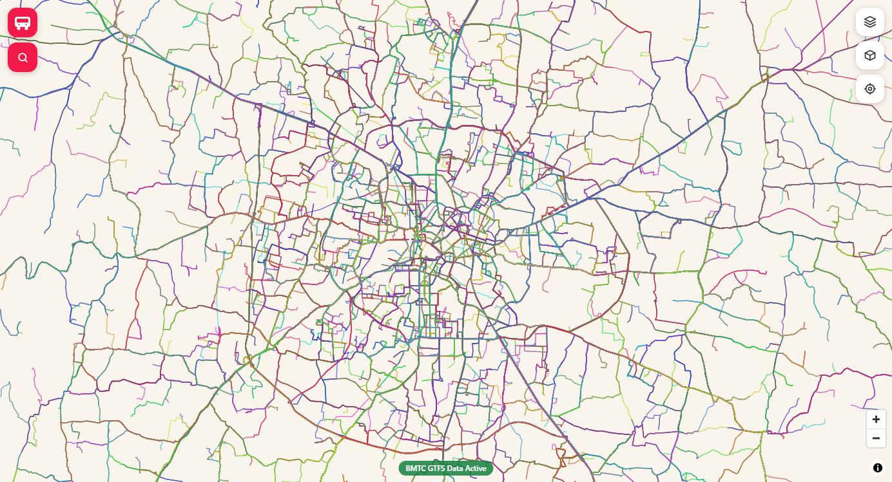
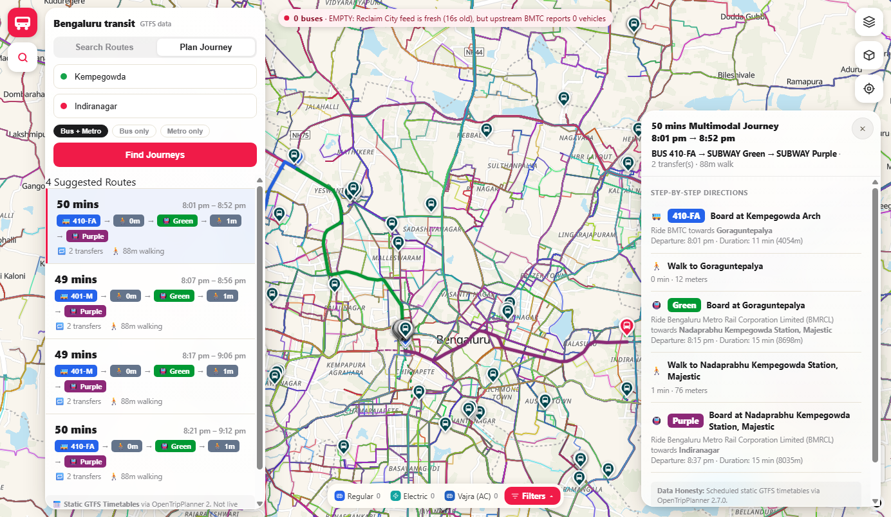
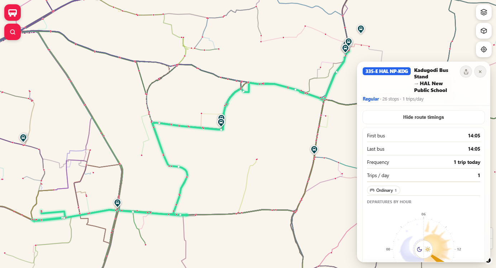
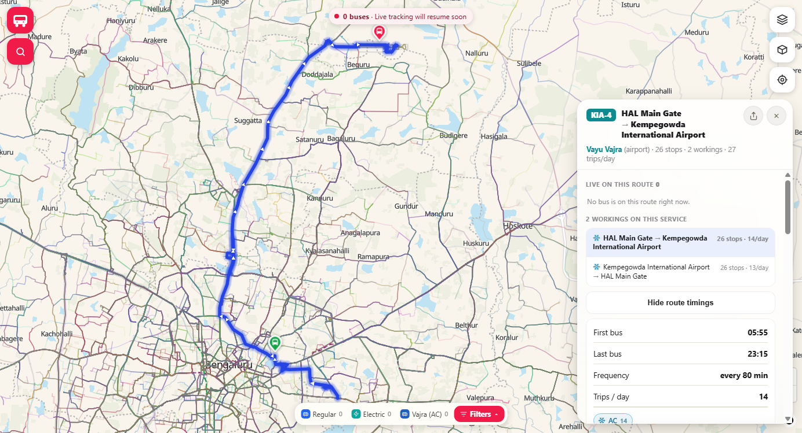
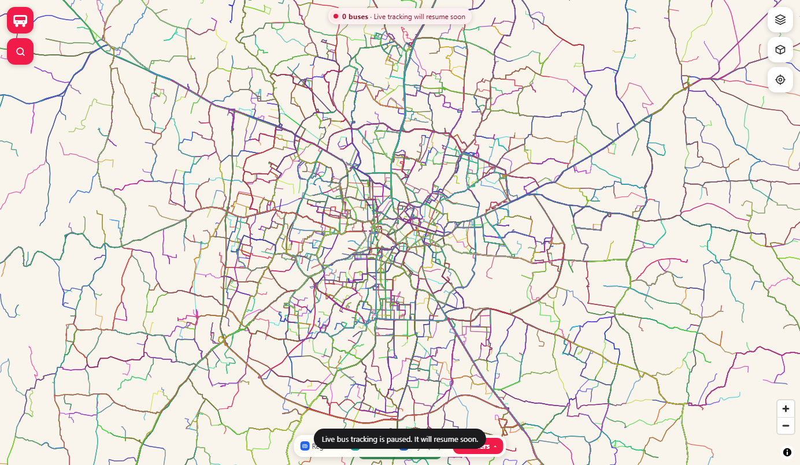
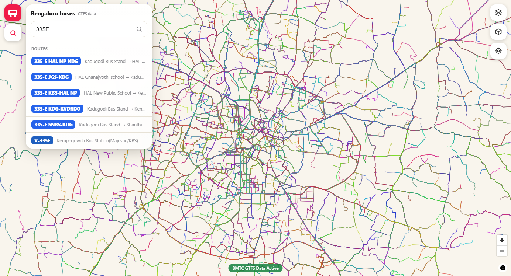
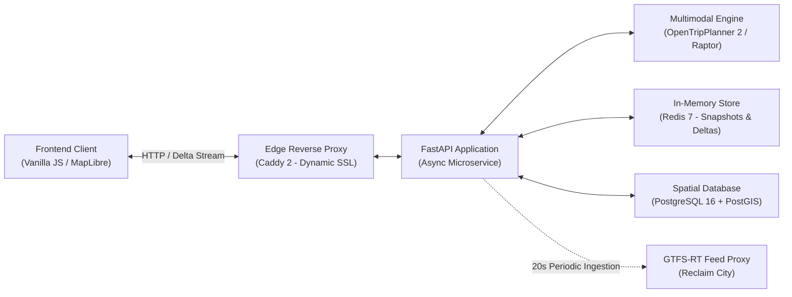

# NAMMA BUS LIVE — Bengaluru Public Transit Intelligence Platform

**Namma Bus Live** is an open-source, web-based public transit intelligence platform built for Greater Bengaluru. It provides an intuitive, high-performance spatial map interface for exploring the city's bus routes, metro lines, stop schedules, and real-time fleet movements.

---

## 1. Project Introduction & Purpose

### Why Namma Bus Live?
Bengaluru's transit network accommodates more than 4 million daily commuters across BMTC bus corridors and the expanding Namma Metro rail lines. Navigating this vast system often presents practical challenges:
* Fragmented transit data across different modes (buses vs. metro rail).
* Opaque tracking systems where static timetable schedules are frequently confused with real-time GPS locations.
* Heavy mobile applications that struggle to load under spotty cellular connectivity.
* Limited bilingual digital transit accessibility for local Kannada speakers.

### What the Platform Delivers
* **Transparent Transit Intelligence:** Clearly distinguishes between active real-time GPS beacons, stale telemetry, and scheduled timetable estimates.
* **Multimodal Journey Guidance:** Combines BMTC city buses with Namma Metro (Purple, Green, and Yellow lines) and walking connections.
* **Instantaneous Client Experience:** Engineered in pure vanilla JavaScript with MapLibre GL and Three.js WebGL—zero bulky frontend framework overhead, ensuring fast load times on mobile devices.
* **Bilingual Inclusivity:** Native English and Kannada (`kn`) support across bus stop search and route descriptions.

---

## 2. Main Website Features

### 2.1 Interactive Map & Visualization
* **MapLibre GL Vector Engine:** Smooth street canvas with GPU-accelerated transit corridors and stop markers.
* **Complete Route Alignments:** High-precision physical road vectors rendered dynamically across major Bengaluru arterial routes.
* **Stop Inspection & Nearby Discovery:** Click to inspect any bus stop or metro station to view route connectivity and upcoming schedules.
* **Procedural 3D WebGL Vehicle Models:** Interactive 3D perspective representations of buses moving along active corridors.

### 2.2 Transit Search & Navigation
* **Fast Route & Stop Autocomplete:** Sub-10ms lookup for route numbers (e.g., `335-E`, `KIA-8`, `500-D`) and bilingual stop names.
* **Stop-by-Stop Timetables:** Comprehensive departure schedules and frequency tables for transit stops.
* **Vayu Vajra Airport Express:** Dedicated airport service discovery with route schedules and terminal stops.

### 2.3 Real-Time Telemetry & Movement
* **Periodic Telemetry Refresh:** Ingests live vehicle telemetry updates every 20 seconds.
* **Differential Delta Tracking:** Incremental position updates reducing client-side network bandwidth consumption by >90%.
* **Dead-Reckoning Animation:** Vector interpolation delivering fluid bus marker movement between GPS beacon pings.
* **Honest Freshness Indicators:**
  * **Active (Green):** Telemetry ping received within <90 seconds.
  * **Stale (Grey):** Last beacon reported between 90 seconds and 10 minutes ago.
  * **Scheduled:** Static timetable estimate when no active GPS transmitter is reporting.

---

## 3. Interface Previews & Screenshots

| Interactive Transit Map & Corridors | Multimodal Journey Route Options |
| :---: | :---: |
|  |  |

| Stop Schedule Timetable Cards | Airport Vayu Vajra Express Guidance |
| :---: | :---: |
|  |  |

| Transparent Live vs Stale Fleet Status | Fast Route & Stop Autocomplete Search |
| :---: | :---: |
|  |  |

---

## 4. Transit Integrations & Data Sources

> **Data Hosting Note:** In compliance with repository guidelines, raw GTFS archives and database dumps are not hosted inside this GitHub repository. Developers and researchers can access the original upstream data sources via the links below.

| Transport System | Original Provider / Maintainer | Source Link | Data Provided & Type |
| :--- | :--- | :--- | :--- |
| **BMTC Bus Network** | **Vivek Matthew** (`bmtc-gtfs`), sourced from Namma BMTC 2.0 app | [GitHub: Vonter/bmtc-gtfs](https://github.com/Vonter/bmtc-gtfs) | **Static:** Over 10,000 stops, 8,000+ route variants, scheduled trips, timetable stop times, and road shapes under [ODbL 1.0](https://opendatacommons.org/licenses/odbl/1-0/). |
| **BMRCL Namma Metro** | Open City Urban Data Portal / BMRCL | [OpenCity Bengaluru Transit](https://opencity.in/tags/bmrcl/) | **Static:** Station coordinates, Purple/Green/Yellow line track alignments, and schedule intervals. |
| **Real-Time Telemetry** | **Reclaim City Bengaluru** Open Transit Proxy | [Reclaim City Transit Map](https://maps.reclaim.city/bmtc/) [Live RT Status](https://maps.reclaim.city/bengaluru/rt/status.json) | **Real-Time:** GTFS-RT Protobuf streams (`vehicle_positions.pb`, `trip_updates.pb`) providing periodic GPS beacons. |
| **Regional Transit** | KSRTC / NWKRTC Public Portals | [KSRTC Official Portal](https://ksrtc.in/) | **Static:** Timetable schedules and major regional terminal connection guidance (Majestic, Shantinagar, Kengeri). |

For complete licensing terms, BibTeX citations, and data provenance, see the [Data Sources Reference](docs/data-sources.md).

---

## 5. Frontend Technology Stack

The public frontend client is deliberately built without heavy JavaScript frameworks to deliver sub-second initial render times:
* **HTML5 & CSS3:** Responsive, mobile-first design with touch-friendly bottom sheets and glassmorphic styling.
* **Vanilla JavaScript (ES2022+):** Frameworkless client architecture eliminating bundle bloat and hydration latency.
* **MapLibre GL JS:** GPU-accelerated vector tile map rendering engine with customized transit styling.
* **Three.js WebGL:** Procedural 3D vehicle geometries and animated camera tracking for immersive bus visualization.

---

## 6. Backend Architecture Overview

*(The backend runs on an independent, private infrastructure stack)*

### High-Level Workflow
1. **Real-Time Ingestion:** An autonomous background worker ingests real-time GTFS-RT Protobuf vehicle positions every 20 seconds.
2. **Caching & Deltas:** Vehicle records are normalized, stored in an in-memory key-value cache, and prepared as incremental differential deltas.
3. **Multimodal Routing:** Origin and destination requests are routed through a dedicated multimodal transit engine using the Raptor algorithm, returning optimal itineraries across buses, metro rail, and walking transfers.
4. **Client Communication:** The frontend communicates with the backend via REST endpoints for autocomplete search and journey planning, while receiving periodic vehicle telemetry updates.

For additional architectural details, see the [Architecture Documentation](docs/architecture.md) and [Public API Reference](docs/api-documentation.md).

---

## 7. Important Disclaimer & User Responsibility

> [!WARNING]
> ### IMPORTANT DISCLAIMER — PLEASE READ
> 
> **NAMMA BUS LIVE is an independent public transportation information platform. It is not officially affiliated with BMTC, BMRCL, KSRTC or any government transport authority.**
> 
> Information is provided for general informational purposes. Data may be incomplete, delayed or inaccurate.
> 
> Users must independently verify transport information before travelling.
> 
> **USE THIS APPLICATION AT YOUR OWN RISK.**

---

## 8. Important Limitations

* **Telemetry Coverage:** BMTC operates approximately 6,000 buses. During peak hours, between 2,200 and 4,500 transmit active GPS beacons to open community feeds. Vehicles without active transmitters are represented via static timetable schedules.
* **Regional Buses (KSRTC):** KSRTC and other regional transport corporations do not provide public real-time GPS feeds. The platform presents static scheduled departures for regional terminals.
* **Traffic Variability:** In high-congestion corridors, real-world arrival times may fluctuate rapidly due to unpredicted road bottlenecks.

---

## 9. Acknowledgements & Credits

* **Vivek Matthew ([@Vonter](https://github.com/Vonter)):** Creator of the open [bmtc-gtfs](https://github.com/Vonter/bmtc-gtfs) project, which made BMTC schedule data available under ODbL 1.0.
* **BMTC & BMRCL:** For operating the foundational bus and metro transit networks of Bengaluru.
* **Reclaim City:** For maintaining open community transit proxies and GTFS-RT Protobuf streams.
* **MapLibre & Three.js Communities:** For building outstanding open-source web mapping and 3D graphics libraries.
