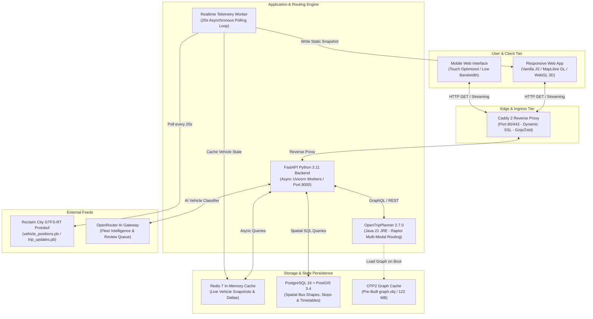

# Namma Bus Live — System Architecture & Engineering Reference

---

## 1. High-Level Architectural Overview

**Namma Bus Live** is engineered as a decoupled, multi-tier transit intelligence platform designed to handle large-scale static timetable data alongside high-throughput real-time telemetry:

---

## 2. Component Tier Details

### 2.1 Frontend Tier (`namma bus live/`)
* **Core Technologies:** HTML5, CSS3, JavaScript (ES2022+), MapLibre GL, Three.js WebGL.
* **Architecture:** Zero-framework, zero-build client application. Eliminates bundler bloat and heavy client-side hydration delays, ensuring sub-second initial paint times on mobile networks.
* **Map Engine (`busmap.js`):** Vector tile rendering powered by MapLibre GL with custom transit layer styling for high-density route overlaps.
* **Live Movement Engine (`live.js`, `delta.js`):**
  * Dead-reckoning spatial interpolation smooths vehicle marker transitions between 20-second polling beacons.
  * Bandwidth optimization via differential delta tracking: the client initially loads `live/vehicles.json` (~1 MB) and subsequently requests incremental delta packets (`/live/delta/{timestamp}`), cutting bandwidth by >90%.
* **3D Visualizations (`three.min.js`, `bmtc3d.js`, `bus3d.js`):** Procedural WebGL bus and metro models providing interactive 3D perspective tracking for individual vehicles.

### 2.2 Backend Application Tier (`backend/`)
* **Framework:** Python 3.11 with FastAPI and Uvicorn asynchronous event loops.
* **Database Drivers:** Asynchronous connection pooling via `asyncpg` and relational modeling via `SQLAlchemy`.
* **Spatial Processing:** Native PostGIS spatial queries (`ST_DWithin`, `ST_Distance`, `ST_AsGeoJSON`, `ST_LineLocatePoint`) for route snapping and nearby stop searches.
* **Telemetry Worker (`backend/app/realtime/manager.py`):** Runs an autonomous `asyncio` background task that periodically fetches, normalizes, and indexes the entire city fleet.

### 2.3 Routing & Multimodal Tier (`otp2`)
* **Engine:** OpenTripPlanner 2.7.0 shaded executable on Eclipse Temurin Java 21 JRE.
* **Algorithm:** Raptor (Round-Based Public Transit Routing) algorithm for Pareto-optimal multi-criteria route optimization (travel time, number of transfers, walking distance).
* **Graph Object (`otp_data/graph.obj`):** 50.96 MB serialized street and transit network incorporating:
  * 10,128 BMTC bus stages.
  * Complete Namma Metro Purple, Green, and Yellow line stations and tracks.
  * Pedestrian street network for walking transfers and access/egress legs.
* **Memory Management:** JVM tuned with `-Xms1024m -Xmx2048m -XX:+UseG1GC` to operate reliably within 4 GB RAM virtual machines.

### 2.4 Persistence & Cache Tier
* **PostgreSQL 16 + PostGIS 3.4:** Stores relational GTFS entities and PostGIS `LineString` / `Point` geometries with spatial GIST indexes.
* **Redis 7:** Ephemeral cache holding:
  * `bmtc:snap:latest`: Serialized current city-wide fleet snapshot.
  * `bmtc:snap:{timestamp}`: Historical rolling snapshot buffer for differential delta calculation.
  * `bmtc:meta:{reg}`: Normalization metadata and classification tags.

---

## 3. Reverse Proxy & Container Ingress

Ingress routing is managed by **Caddy 2**:
* **Zero-Downtime TLS:** Automatically negotiates and renews Let's Encrypt / ZeroSSL HTTPS certificates when pointed to a production domain.
* **Raw IP Fallback:** Gracefully serves plain HTTP on port 80 during initial staging via `{$DOMAIN::80}` without SSL handshake aborts.
* **Compression:** HTTP responses are compressed with `zstd` and `gzip`.
* **Security Headers:** Enforces `nosniff`, `DENY` frame embedding, and strict referrer policies.
